

  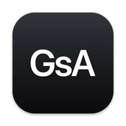

<h1 align="center">G's Avengers</h1>

<b>Your Windows habits, your clipboard and your Windows keyboard & mouse, all on your Mac, from one menu-bar icon.</b>

  <a href="https://github.com/GauthamWho/GsAvengers/releases/latest"><b>Download for Mac</b></a> ·
  <a href="https://github.com/GauthamWho/GsAvengers/releases/latest"><b>Download for Windows</b></a> ·
  <a href="#install-on-mac">Install</a> ·
  <a href="#pair">Pair</a> ·
  <a href="#windows-keyboard-cheat-sheet">Cheat sheet</a>

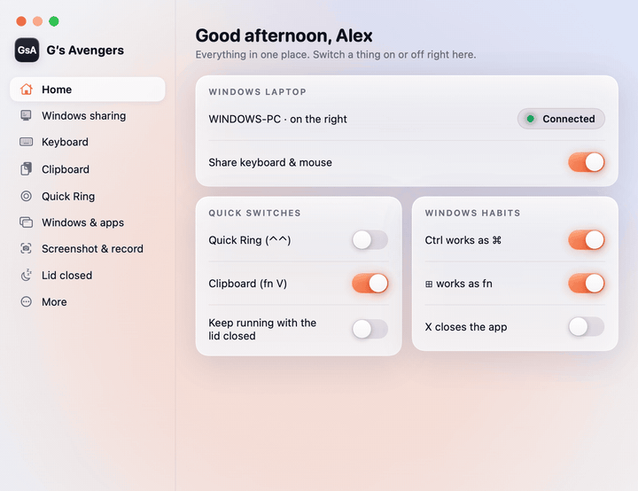

---

## Use one Windows keyboard & mouse on your Mac

Put your Windows laptop next to your Mac. Move the mouse off the edge of the Windows screen and the pointer **lands on the Mac**. The Windows keyboard types there, and it **behaves the Windows way**: Ctrl+C is copy, Home goes to the start of the line, Alt+Tab switches apps, Alt+F4 closes them.

- **Finds the Mac by itself** on your home Wi-Fi. No IP address, no account, no cloud.
- **Pair once** with a 6-digit number you check on both screens.
- **Encrypted** end to end: ECDH P-256 key exchange, AES-256 + HMAC on every message.
- **Clipboard both ways**: copy on Windows, paste on the Mac, and back. Text and pictures.
- **Your Mac stays yours**: touch the Mac's own trackpad and the pointer comes back at once.
- **Every key rule is a switch**, so you keep only the habits you want.

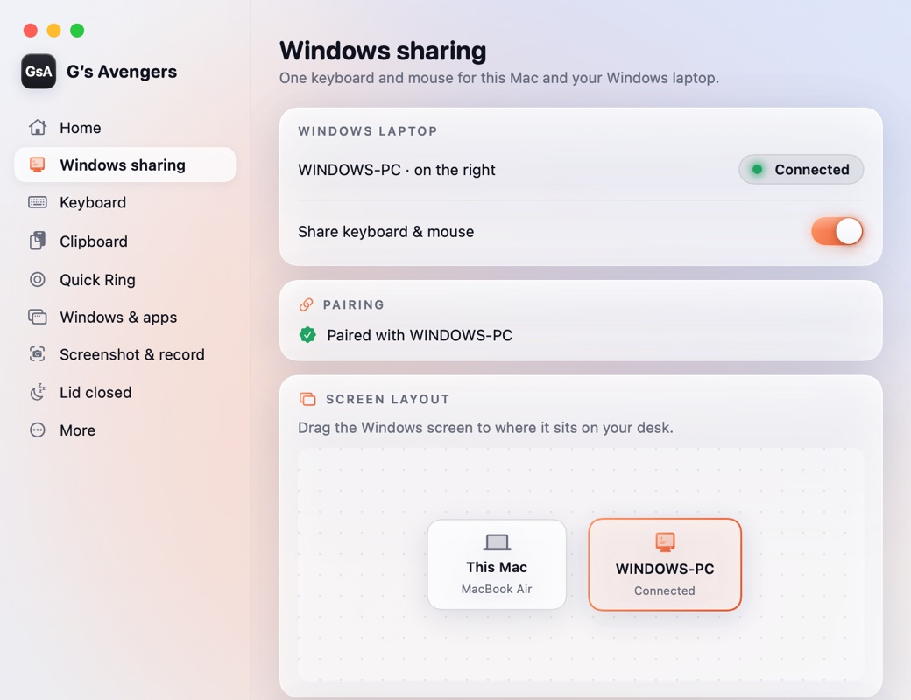

## Highlights

<table>
<tr>
<td width="50%"> <b>One window, nine pages.</b> Click the GsA icon in the menu bar. Everything is a switch: Home, Windows sharing, Keyboard, Clipboard, Quick Ring, Windows & apps, Screenshot & record, Lid closed and More.</td>
<td width="50%">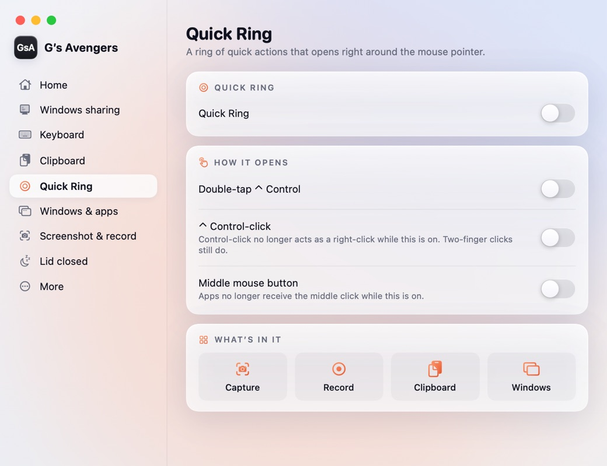 <b>Quick Ring.</b> Double-tap <kbd>⌃ Control</kbd> and a glass ring opens right at the mouse: Capture, Record, Clipboard, Windows.</td>
</tr>
<tr>
<td>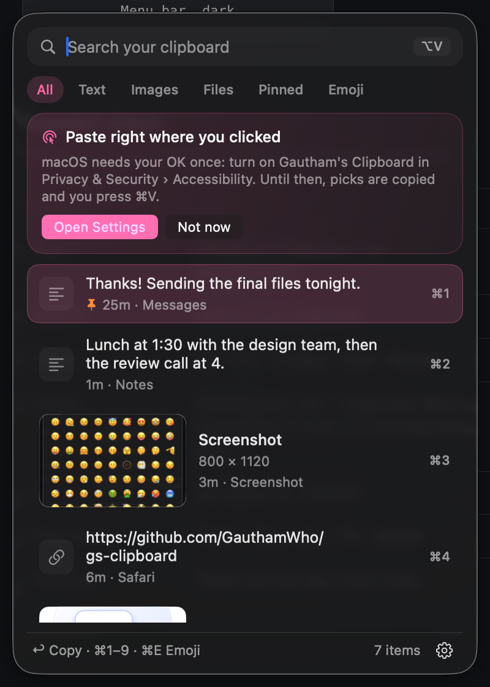 <b>Clipboard history and emoji.</b> <kbd>fn V</kbd> opens your history where you are typing; <kbd>fn E</kbd> opens emoji. History stays on your Mac.</td>
<td>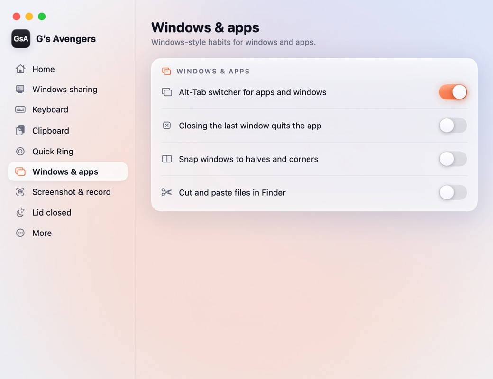 <b>Windows habits for every app.</b> A Windows-style app switcher that also lists browser tabs, the red X that really closes the app, window snapping, and cut & paste for files in Finder.</td>
</tr>
<tr>
<td>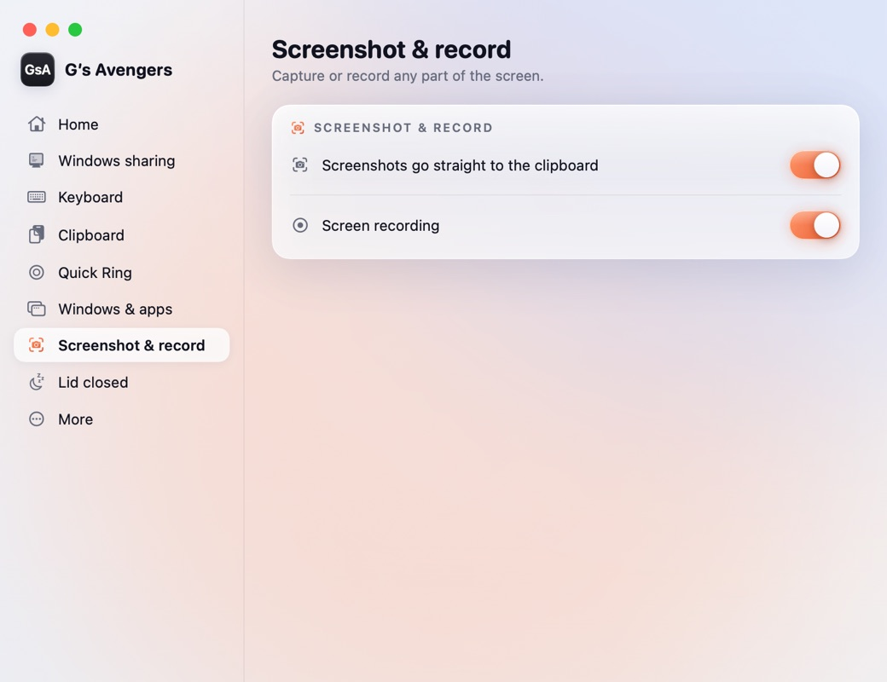 <b>Screenshot straight to the clipboard</b> and a <b>screen recorder</b>, one click each.</td>
<td>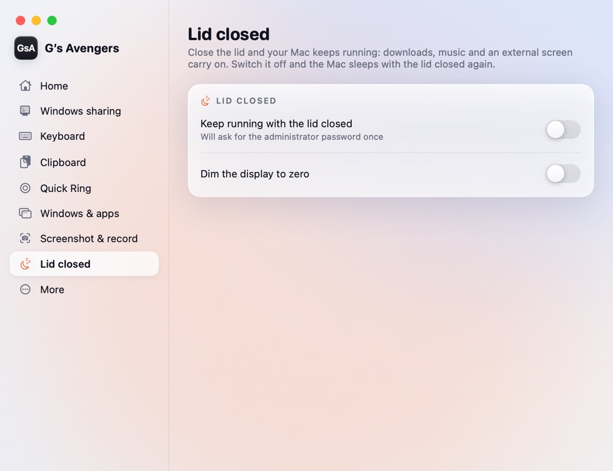 <b>Keep running with the lid closed</b>, for when the Mac sits shut beside your Windows laptop.</td>
</tr>
</table>

## All features

- **One window** from the GsA menu-bar icon, with 9 pages
- **Windows sharing**: one Windows keyboard & mouse drives the Mac over your home Wi-Fi, 6-digit pairing, encrypted, LAN only
- **Windows keyboard works the Windows way** on the Mac (Ctrl = ⌘, ⊞ = fn, Home/End, Ctrl+arrows, Alt+Tab, Alt+F4, Print Screen…), each rule switchable
- **Clipboard sync** both ways between Windows and the Mac
- **Mac trackpad takes the pointer back** at any time
- **Windows-style app switcher** with browser tabs
- **X closes the app**, like on Windows
- **Window snapping**
- **Cut & paste files in Finder** (⌘X, ⌘V)
- **Clipboard history** (fn V) and **emoji** (fn E)
- **Screenshot straight to the clipboard**
- **Screen recorder**
- **Quick Ring**: double-tap ⌃ Control for a glass ring with Capture, Record, Clipboard and Windows
- **Keep running with the lid closed**
- Plus the Vorssaint toolbox under **More** (Dock preview, smooth scrolling, focus follows mouse and more)
- **No servers**: the Vorssaint online services are switched off in this build

## How the setup looks

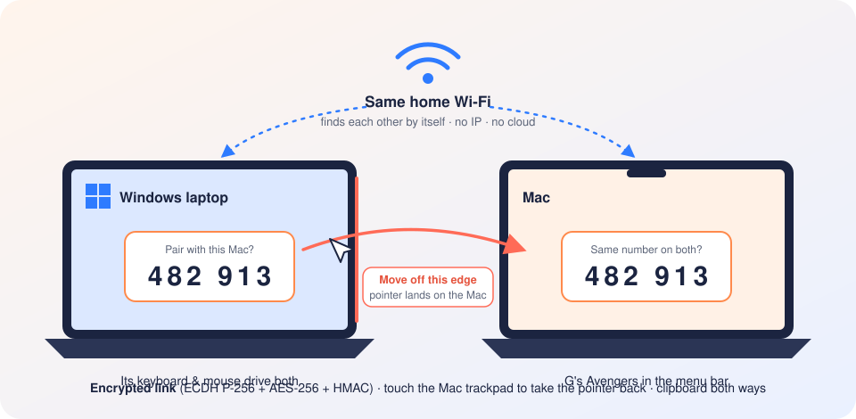

  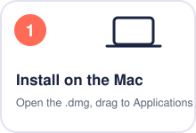
  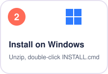
  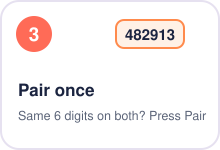
  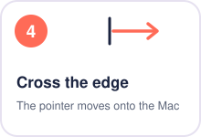

## Install on Mac

**Needs:** macOS 14 Sonoma or newer, on an Apple Silicon Mac (M1 or later).

1. Download **`GsAvengers-mac-1.0.0.dmg`** from the [latest release](https://github.com/GauthamWho/GsAvengers/releases/latest).
2. Open it and drag **G's Avengers** onto **Applications**.
3. The first time, **right-click the app → Open → Open**.
   The app is code-signed with the project's own certificate but **not notarized** by Apple (no paid Apple Developer ID yet), so macOS warns once. On newer macOS, if there is no Open button: try to open it once, then go to **System Settings → Privacy & Security** and click **Open Anyway**.
4. Click the **GsA** icon in the menu bar. Grant **Accessibility** when asked: it is needed to type and move the pointer for the Windows keyboard, and for the window tools.

## Install on Windows

**Needs:** Windows 10 or 11 (uses the .NET Framework 4 that ships with Windows), on the same Wi-Fi as the Mac.

1. Download **`GsAvengers-windows-1.0.0.zip`** from the [latest release](https://github.com/GauthamWho/GsAvengers/releases/latest) and **Extract All**.
2. Double-click **`INSTALL.cmd`**. It builds the app from the included source with the compiler already inside Windows (or uses the ready-made `prebuilt\GsAvengers.exe`), runs a self-test, and installs it for your user. No admin rights.
3. The exe is **not code-signed**: if SmartScreen appears, click **More info → Run anyway**. If the firewall asks, allow **Private networks**.

Full guide: [WINDOWS-INSTALL.md](Modules/GsShare/WINDOWS-INSTALL.md).

## Pair

1. On the Mac: GsA icon → **Windows sharing**, with **Share keyboard & mouse** on.
2. The Windows app finds the Mac by itself within a few seconds.
3. Both screens show the **same 6-digit number**. If they match, click **Pair** on both.
4. Drag the screens so they match your desk (Windows on the left, right, above or below).
5. Move the mouse off that edge of the Windows screen. You are on the Mac.

You pair only once. Next time they connect by themselves.

## Windows keyboard cheat sheet

What each Windows key does on the Mac. Every row is a switch on the **Keyboard** page.

| On the Windows keyboard | On the Mac |
|---|---|
| **Ctrl** + C, V, X, Z, A, S, F, N, O, P, T, W, R, L… | **⌘ Command** + the same key |
| **⊞ Windows** key | **fn**: ⊞+V clipboard, ⊞+E emoji, ⊞+Space dictation |
| Ctrl+Space | fn Space (dictation shortcut) |
| Ctrl+Y | Redo (⌘⇧Z) |
| Home / End (+Shift) | Start / end of the line (select with Shift) |
| Ctrl+Home / Ctrl+End | Top / bottom of the document |
| Ctrl+← / → (+Shift) | Jump (or select) a word at a time |
| Ctrl+Backspace / Ctrl+Delete | Delete a whole word |
| Ctrl+Tab (+Shift) | Next / previous browser tab |
| Alt+Tab (hold Alt) | App switcher, keeps cycling while Alt is held |
| Alt+F4 | Quit the app (⌘Q) |
| Ctrl+F4 | Close the window or tab (⌘W) |
| Ctrl+Shift+Esc | Force Quit (⌘⌥Esc) |
| Print Screen | Snip an area to the clipboard |
| ⊞+L | Lock the Mac |
| ⊞+D | Show the desktop |
| ⊞+Tab | Mission Control |
| ⊞+. | Emoji panel |
| ⊞+E *(off by default)* | Open a Finder window |
| **Finder:** F2 · Delete · Enter · Backspace | Rename · Move to Trash · Open · Back a folder |
| **Terminals:** Ctrl | Stays ⌃ Control (Ctrl+C stops, Ctrl+R, Ctrl+D…) |
| **Terminals:** Ctrl+V, Ctrl+Shift+C / V | Paste and copy, like Windows Terminal |
| **Terminals:** Home / End, Ctrl+Backspace | ⌃A / ⌃E line ends, ⌃W delete word |

## Privacy & security

- **Local only.** The Mac and the PC talk directly on your home network. Both ignore computers with internet (non-private) addresses. No cloud, no relay, no account, no analytics.
- **No servers.** Update checks, share links and feedback uploads inherited from Vorssaint are switched off.
- **Paired, then encrypted.** A new computer is accepted only after you compare the same 6-digit number on both screens and click Pair on both. Each connection uses a fresh P-256 key exchange; every message is AES-256 encrypted, HMAC-SHA256 signed and numbered, so it cannot be changed or replayed. Before pairing, no keyboard, mouse or clipboard data is accepted.
- **Your typing is never stored.** Keys from Windows are turned into Mac key presses and forgotten. The logs hold connection messages only.
- **Clipboard history stays on your Mac.**
- **Lid-closed mode** asks for your admin password once, to add one rule that lets the app run only `pmset disablesleep 0/1`, nothing else.

Details: [SECURITY.md](SECURITY.md) · [security review](SECURITY-REVIEW.md) · [protocol](Modules/GsShare/docs/PROTOCOL.md) · [privacy](docs/PRIVACY.md) · [permissions](docs/PERMISSIONS.md)

## Roadmap

- **Mac → Windows**: the Mac's keyboard and trackpad driving the Windows PC
- **Mac → Mac**: share between two Macs
- **3 or more computers** in one layout

## Want something?

Open an [issue](https://github.com/GauthamWho/GsAvengers/issues) or start a [Discussion](https://github.com/GauthamWho/GsAvengers/discussions) and we'll build it.

## Licence

This repository has **two licences**, explained in plain words in [NOTICE](NOTICE):

- **The main Mac app** (everything outside `Modules/GsShare` and `Modules/GsClipboard`) is a modified version of [Vorssaint](https://github.com/vorssaint/vorssaint-utils) and is licensed under **GPL-3.0-or-later** ([LICENSE](LICENSE)). The GPL lets anyone use, study, change, rebuild and share this part under the same licence. That cannot be taken away, because it is built on GPL code.
- **The sharing app (Mac + Windows) and the clipboard helper** (`Modules/GsShare`, `Modules/GsClipboard`) are GauthamWho's own original code: **all rights reserved**, source-available for reading, free for personal use (official builds, or your own unmodified build); no copying, modifying, redistributing or derivative works without permission ([GsShare licence](Modules/GsShare/LICENSE), [GsClipboard licence](Modules/GsClipboard/LICENSE)).

## Credits

- Built on **[Vorssaint](https://github.com/vorssaint/vorssaint-utils)** by Vorssaint and its contributors (GPL-3.0-or-later): the menu-bar app, switcher, window tools, capture, recorder and much more come from there. Thank you! "Vorssaint" is their trademark; this fork uses its own name, icon and identifiers ([TRADEMARKS.md](TRADEMARKS.md)).
- G's Avengers, the sharing app, the clipboard helper and the Frost window: **[GauthamWho](https://github.com/GauthamWho)**.
